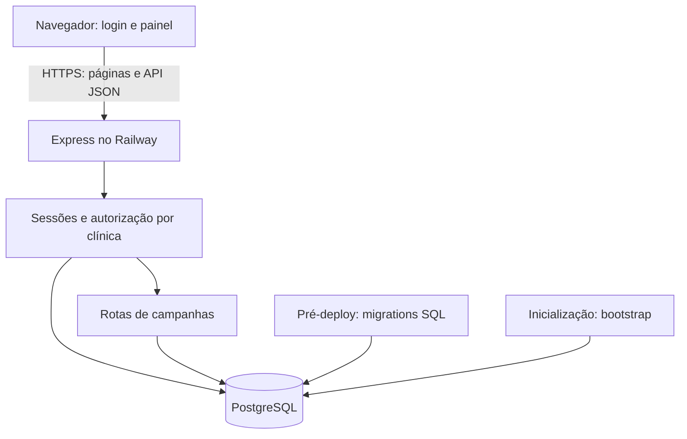
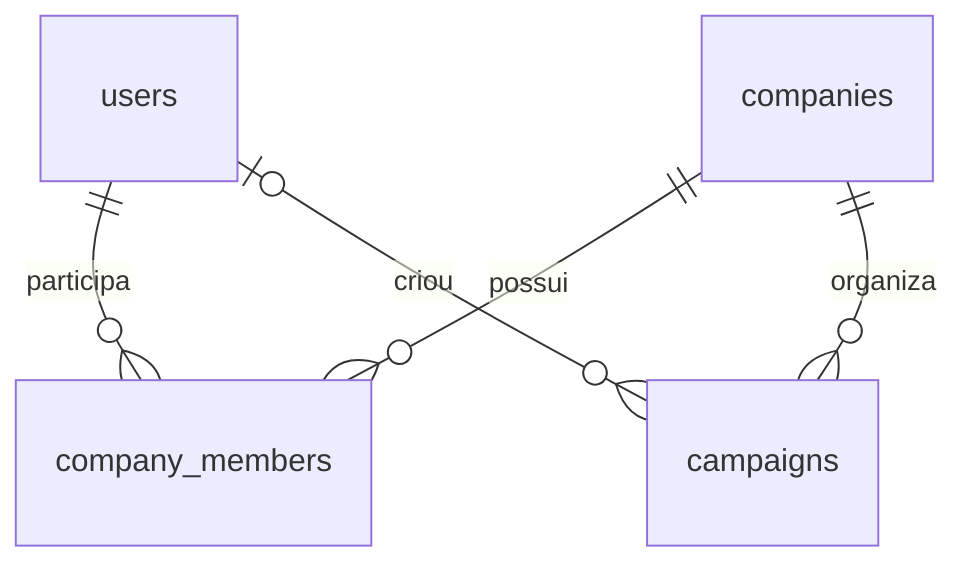

# Arquitetura atual

Referência: 24/10/2026, código até 8860d6e. Este documento descreve o que existe; propostas futuras ficam no [backlog](BACKLOG.md).

## Visão geral

Aplicação monolítica: o mesmo processo Express entrega as páginas e a API JSON. Navegador e API usam a mesma origem. O PostgreSQL persiste dados do negócio e sessões; o navegador mantém apenas uma cópia de trabalho dos rascunhos carregados.



Não existe conexão do navegador diretamente ao banco. Não existem chamadas ao Meta ou a provedores de IA no fluxo atual.

## Organização dos arquivos

| Caminho | Responsabilidade |
|---|---|
| src/server.js | Configuração do Express, segurança, sessões, login/logout, perfil, páginas, health checks e ciclo de vida |
| src/db.js | Pool compartilhado de conexões PostgreSQL |
| src/bootstrap.js | Primeiro usuário e clínicas iniciais |
| src/campaigns.js | Rotas de rascunhos e autorização por clínica |
| src/briefing.js | Validação e normalização do briefing; middleware de POST/PUT |
| src/migrate.js | Execução transacional das migrations e controle de aplicação |
| src/migrations/001_initial.sql | Usuários, empresas e vínculos |
| src/migrations/002_sessions.sql | Arquivo histórico vazio; não cria tabela |
| src/migrations/003_fix_user_sessions.sql | Criação efetiva de user_sessions e índice de expiração |
| src/migrations/004_campaigns.sql | Rascunhos e índice por clínica/data |
| src/migrations/005_campaign_briefing.sql | Coluna briefing JSONB, padrão vazio e restrição de objeto |
| public/index.html | Estrutura do painel e formulário modal |
| public/app.js | Perfil, seleção de clínica, navegação, busca e operações da API |
| public/styles.css | Estilos compartilhados e layout aprovado |
| public/login.html e public/login.js | Tela e envio do login |
| railway.json | Pré-deploy, início e caminho do health check |
| package.json e package-lock.json | Scripts e dependências |

## Inicialização e infraestrutura

1. dotenv carrega variáveis locais; no Railway elas vêm do serviço.
2. db.js exige DATABASE_URL e configura o pool.
3. server.js exige SESSION_SECRET com pelo menos 32 caracteres e APP_URL válida. Em produção APP_URL precisa usar HTTPS.
4. Antes de abrir a porta, executa bootstrap e prepara um hash auxiliar para verificações de login.
5. Escuta em 0.0.0.0 e na variável PORT; sem PORT usa 3000.
6. SIGTERM e SIGINT acionam encerramento do servidor, do armazenamento de sessões e do pool, com limite de 10 segundos.

As migrations são um comando separado, executado antes do servidor pelo pré-deploy. npm start sozinho não aplica migrations.

Pool: máximo 5 conexões por processo; espera para conexão de 5 segundos; conexão ociosa de 30 segundos; statement_timeout de 5 segundos e query_timeout de 6 segundos. Aumentar réplicas também aumenta o potencial de conexões.

## Modelo de dados



| Tabela | Campos e regras principais |
|---|---|
| users | UUID id; name até 120; email até 254, único, normalizado em minúsculas/sem espaços externos; password_hash; created_at |
| companies | UUID id; name até 160; city até 120; state até 2; created_at |
| company_members | PK composta company_id/user_id; role owner/admin/member; created_at; FKs com cascata; índice por user_id |
| campaigns | UUID id; company_id obrigatório; created_by opcional; name até 120; objective; budget_cents inteiro; status; created_at; briefing JSONB não nulo, padrão {} |
| user_sessions | sid como PK; sess JSON; expire TIMESTAMP(6); índice em expire |
| schema_migrations | name como PK; applied_at; criada pelo executor |

Exclusão de empresa remove vínculos e campanhas por cascata. Exclusão de usuário remove vínculos e deixa created_by das campanhas como NULL. Não há endpoints administrativos para essas exclusões.

Sessões não têm uma FK de usuário: o identificador fica dentro do JSON da sessão. Campanhas possuem created_by para autoria inicial, mas ainda não registram autor ou horário de cada edição.

### Briefing de campanha

A migration 005 adiciona campaigns.briefing como JSONB NOT NULL DEFAULT '{}', com CHECK para garantir que seja objeto. Registros antigos recebem objeto vazio. A estrutura dos campos é validada na aplicação, não individualmente pelo CHECK do banco.

| Chave JSON | Campo | Limite de caracteres |
|---|---|---|
| service | Serviço/procedimento | 120 |
| offer | Oferta/proposta | 500 |
| audience | Público desejado | 300 |
| region | Cidade/região | 200 |
| message | Mensagem principal | 500 |
| destination | Destino desejado | 200 |
| notes | Observações | 500 |

Todos são opcionais enquanto rascunho. Valores enviados precisam ser strings dentro do limite; espaços externos são removidos. Chaves desconhecidas, arrays, null e tipos incorretos são rejeitados com 400.

Sem a propriedade briefing, POST usa {} e PUT mantém o valor anterior por COALESCE. Quando briefing é enviado, substitui o objeto inteiro: campos omitidos dentro dele viram strings vazias. Enviar {} limpa todos os campos; não é uma operação de merge parcial. Clientes devem enviar o objeto completo ao editar.

GET, POST e PUT devolvem briefing junto dos demais campos. destination é texto de planejamento: não é validado como URL, não é acessado pelo servidor e não configura automaticamente um destino Meta.

### Regras de campanhas

- Nome obrigatório, sem aceitar somente espaços, máximo de 120 caracteres.
- Objetivos permitidos: Conversas no WhatsApp, Geração de leads e Reconhecimento.
- Orçamento entre R$ 1,00 e R$ 100.000,00 por dia. Internamente entre 100 e 10.000.000 centavos inteiros.
- Apenas status draft existe, inclusive com restrição no banco.
- São rascunhos internos. Os objetivos ainda não são mapeamentos validados dos enums da API Meta.
- GET ordena por created_at DESC e id DESC.
- PUT altera nome, objetivo, orçamento e briefing enviado; preserva id, clínica e autoria inicial.
- DELETE é exclusão física, sem lixeira.
- Não existem updated_at, histórico de versões ou bloqueio contra edição concorrente. Hoje a última gravação pode sobrescrever uma anterior.

## Autenticação e autorização

Login normaliza e-mail, busca o usuário e compara senha com bcrypt. O bootstrap usa custo 12. Mesmo para usuário ausente há comparação com hash auxiliar. Erro de credenciais é genérico.

Após autenticação, a sessão é regenerada, recebe userId e é salva antes da resposta. O navegador recebe cookie meta_ads_sid; o conteúdo da sessão fica no PostgreSQL. Configuração: httpOnly, sameSite=lax, secure em produção e maxAge de 8 horas. Não existe JWT ou token em localStorage.

Logout destrói a sessão e limpa o cookie. /api/me recupera o usuário e as clínicas vinculadas, com o papel em cada uma.

| Papel na clínica | Listar | Criar | Editar | Excluir |
|---|---|---|---|---|
| owner | Sim | Sim | Sim | Sim |
| admin | Sim | Sim | Sim | Sim |
| member | Sim | Não | Não | Não |
| Sem vínculo | Não | Não | Não | Não |

Cada operação de campanhas verifica a sessão, valida UUIDs e consulta company_members. UPDATE e DELETE filtram simultaneamente id, company_id e status. A clínica recebida na URL nunca é suficiente para conceder acesso.

O isolamento está implementado na aplicação; não há política PostgreSQL RLS nas migrations. Owner e admin têm as mesmas capacidades atuais em campanhas; gestão de membros ainda não foi construída.

## Segurança implementada e limites

- helmet, remoção de X-Powered-By e JSON limitado a 16 KB.
- trust proxy = 1, compatível com a topologia pretendida; revisar se a infraestrutura mudar.
- Escritas em /api exigem Origin igual à origem de APP_URL e Content-Type application/json. Isso também vale para login, logout e DELETE.
- APIs usam Cache-Control: no-store.
- Rate limit no login: 10 tentativas na janela de 15 minutos, sem contar as bem-sucedidas; armazenamento padrão em memória do processo.
- SQL parametrizado; conteúdo de campanhas renderizado com textContent no navegador.
- Páginas / e /index.html redirecionam visitantes sem sessão para /login.
- Logs de erro da API registram código e caminho, sem devolver detalhes internos ao cliente.

Essas medidas não equivalem a uma auditoria completa. Não há MFA, recuperação de senha, rate limit distribuído, trilha de auditoria, revogação administrativa de sessões ou testes automatizados versionados. JSON malformado e alguns erros internos passam pelo handler genérico 500; refinar a classificação está no backlog.

## Contrato da API

Prefixo de campanhas: /api/companies/:companyId/campaigns.

| Método e caminho | Acesso | Resposta principal |
|---|---|---|
| GET /health | Público | 200: status ok; não verifica banco |
| GET /health/db | Público | 200 connected; 503 unavailable |
| POST /api/login | Origem válida + JSON | 200 ok; 401 credenciais; 429 limite |
| POST /api/logout | Autenticado + origem/JSON | 200 ok |
| GET /api/me | Autenticado | user e companies com role |
| GET prefixo | Vinculado | 200 com campaigns |
| POST prefixo | owner/admin | 201 com campaign |
| PUT prefixo/:campaignId | owner/admin | 200 com campaign |
| DELETE prefixo/:campaignId | owner/admin | 200 ok |

Payload completo para POST e PUT:

```json
{
  "name": "Avaliação de ortodontia",
  "objective": "Conversas no WhatsApp",
  "budgetCents": 3000,
  "briefing": {
    "service": "Ortodontia infantil",
    "region": "Campinas",
    "destination": "WhatsApp da clínica"
  }
}
```

campaign devolve id, company (alias de company_id), name, objective, budgetCents, status e briefing. GET devolve { "campaigns": [...] }; POST/PUT devolvem { "campaign": {...} }; exclusão devolve { "ok": true }.

Erros de campanhas: 400 para UUID ou dados inválidos; 401 para sessão ausente; 403 para vínculo/papel insuficiente; 404 para rascunho inexistente naquela clínica em edição/exclusão. Middleware de escrita também pode retornar 403 por origem e 415 por formato. Falhas não tratadas chegam ao handler 500.

## Frontend

loadProfile chama /api/me e preenche o seletor com dados reais. loadDrafts limpa o estado anterior e consulta a clínica selecionada. render calcula indicadores, filtra a busca por nome/objetivo e monta as linhas com texto seguro.

O modal é compartilhado: editingId nulo cria via POST; preenchido edita via PUT. Ao abrir nova campanha, o formulário é reiniciado. Durante requisições o estado busy desabilita ações e a troca de clínica. Falhas de gravação aparecem no formulário; falhas de carga não são apresentadas como uma lista vazia bem-sucedida. Respostas 401 encaminham para /login.

A busca é local sobre todos os rascunhos carregados. Não há paginação nem persistência da última clínica selecionada. Os cards de campanhas Meta e resultados ainda não possuem dados reais.

O formulário inclui uma seção expansível de briefing, preenchida ao editar e limpa ao criar. Para member, o botão Ver abre o formulário com campos desabilitados e sem botão de salvar; POST/PUT/DELETE continuam bloqueados no servidor. A busca atual continua por nome/objetivo, sem pesquisar o briefing.
